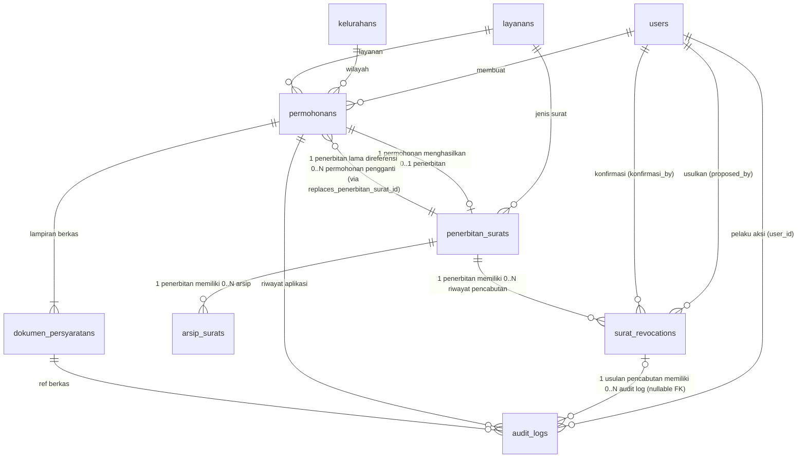
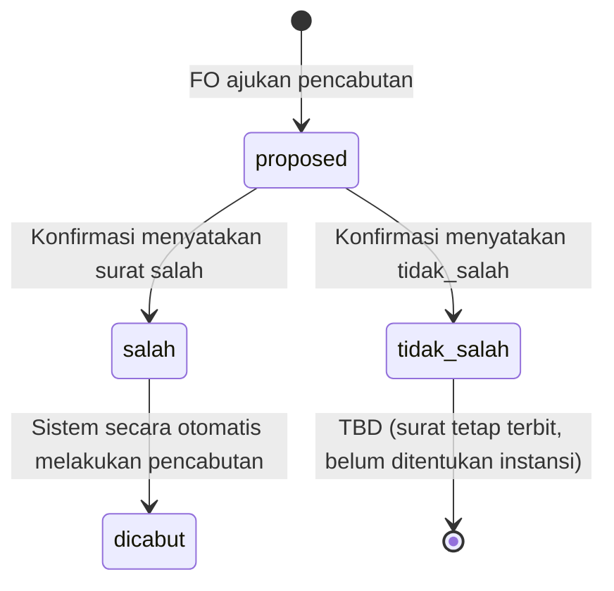
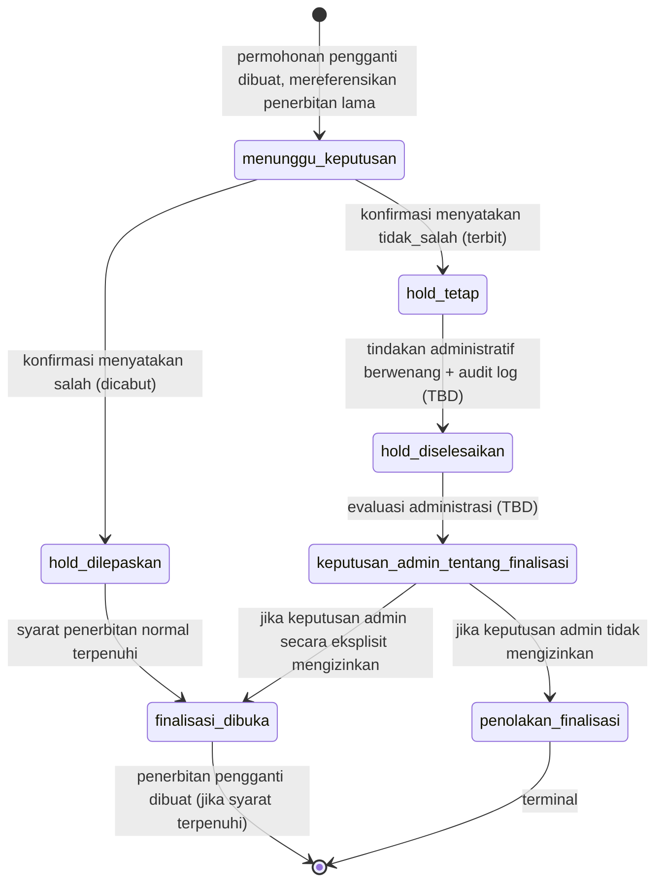

# Spesifikasi Teknis Final — Pencabutan Surat KMU (Revisi Terbaru)

**Status:** DOKUMENTASI DESAIN FINAL — REVISI TERBARU
**Batasan mutlak:** Hanya dokumentasi spesifikasi. Tidak ada perubahan source code, migration, database, konfigurasi, file aplikasi, atau Git state. Tidak ada akses ke `.env`, SQLite/WAL/SHM, `storage/app/private`, dokumen warga, atau data pribadi. Tidak ada eksekusi aplikasi, test, Tinker, migration, seeder, atau perintah yang mengakses database.

---

## 1. Daftar Perubahan dari Revisi Sebelumnya

| # | Aspek | Sebelumnya | Sesudah (Revisi Ini) | Alasan |
|---|-------|------------|----------------------|--------|
| 1 | Tabel CHECK constraint (bagian 1) | `status = 'proposed'` ⇒ `active_penerbitan_surat_id = penerbitan_surat_id` | `status = 'proposed'` ⇒ `active_penerbitan_surat_id = penerbitan_surat_id` | Koreksi teks rusak dan simbol |
| 2 | Acceptance criteria nomor 2 (bagian 14) | CHECK constraint hanya “jika didukung driver” | UNIQUE constraint wajib; CHECK constraint atau mekanisme setara pada level database wajib; validasi aplikasi dan transaksi sebagai lapisan tambahan | Konsisten dengan bagian 5.3, 12, dan 14 |
| 3 | Aturan HOLD `approved` (bagian 6) | Konfirmasi menyatakan salah → status `dicabut` → HOLD `hold_dilepaskan` | Konfirmasi menyatakan `salah` → otomatis dicabut; `tidak_salah` → tetap `terbit`; tidak ada mekanisme approve/reject atas usulan FO; HOLD `hold_dilepaskan` dilepas saat `salah`, tetap aktif saat `tidak_salah` | Mekanisme konfirmasi pejabat penggantikan approve/reject: `salah` otomatis dicabut, `tidak_salah` tetap `terbit`, tidak ada approve/reject subjektif |

---

## 2. Ringkasan Keputusan Bisnis (Dipertahankan Tanpa Perubahan)

| # | Keputusan |
|---|-----------|
| 1 | Pengusul pencabutan hanya **FO**. |
| 2 | Pejabat berwenang untuk TTE adalah pejabat penandatangan TTE surat tersebut yang melakukan konfirmasi hasil pemeriksaan. Tidak ada mekanisme delegasi atau pejabat pengganti. |
| 3 | Surat tanpa TTE tetap dapat dicabut. Pejabat berwenang untuk non-TTE adalah **TBD** sampai dikonfirmasi instansi. |
| 4 | Surat langsung berstatus `suspend` setelah usulan pencabutan berhasil dicatat. |
| 5 | Jika konfirmasi menyatakan surat salah, sistem melakukan pencabutan secara otomatis dan surat menjadi `dicabut` secara permanen. |
| 6 | Jika konfirmasi menyatakan tidak salah, transisi status adalah **TBD** sampai dipastikan instansi. |
| 7 | Warga boleh membuat permohonan pengganti ketika pencabutan surat lama masih menunggu keputusan. |
| 8 | Permohonan pengganti boleh diproses, tetapi finalisasi penerbitannya HOLD sampai keputusan pencabutan surat lama selesai. |
| 9 | Arsip PDF TTE menggunakan tabel terpisah `arsip_surats`, bukan `dokumen_persyaratans`. |
| 10 | QR surat lama tetap dapat diakses setelah `suspend` maupun `dicabut`. Token tidak dihapus dan tidak dibuat 404. |
| 11 | Alasan pencabutan dan catatan keputusan bersifat internal. |
| 12 | `document_reviews` tetap terpisah dari workflow pencabutan. |
| 13 | Integrasi BSrE/TTE di-bypass untuk sementara; fokus pengerjaan saat ini adalah halaman verifikasi surat. Integrasi TTE adalah pekerjaan lanjutan, bukan dianggap selesai atau tidak diperlukan. |

---

## 3. Entity Relationship Diagram dan Kardinalitas



**Keterangan kardinalitas:**
- `permohonans ||--o| penerbitan_surats`: satu permohonan menghasilkan nol atau satu penerbitan; satu penerbitan berasal dari tepat satu permohonan. Kolom `penerbitan_surats.permohonan_id` wajib `NOT NULL` dan `UNIQUE`.
- `penerbitan_surats ||--o{ permohonans`: satu penerbitan lama dapat direferensikan oleh nol atau banyak permohonan pengganti (relasi melalui `permohonans.replaces_penerbitan_surat_id`).
- `penerbitan_surats ||--o{ arsip_surats`: satu penerbitan memiliki nol atau banyak arsip (jumlah nonaktif boleh lebih dari satu).
- `penerbitan_surats ||--o{ surat_revocations`: satu penerbitan memiliki nol atau banyak riwayat pencabutan.
- `surat_revocations o|--o{ audit_logs`: satu usulan pencabutan memiliki nol atau banyak entri audit log (relasi opsi melalui FK nullable `audit_logs.surat_revocation_id`).
- `permohonans ||--o{ audit_logs`: satu permohonan memiliki nol atau banyak audit log.

---

## 4. State Machine

### 4.1 Status Hukum Penerbitan (`penerbitan_surats.status`)

```mermaid
stateDiagram-v2
    [*] --> null_belum_terbit : baris dibuat pada finalisasi proses
    null_belum_terbit --> terbit : syarat hukum terpenuhi (TTE: bukti PDF resmi + SHA-256; non-TTE: kewenangan terpenuhi)
    terbit --> suspend : FO usulkan pencabutan
    suspend --> suspend_konfirmasi : FO usulkan pencabutan, status hukum tetap `suspend`
    suspend_konfirmasi --> dicabut : Konfirmasi menyatakan surat salah, pencabutan otomatis
    dicabut --> [*] : terminal
```

**Catatan penting:**
- `status` **tidak memiliki default** dan awalnya bernilai `NULL` setelah baris dibuat pada tahap finalisasi proses.
- `NULL` berarti record proses penerbitan belum memenuhi syarat hukum dan **bukan** surat yang telah diterbitkan.
- Aturan QR, pencabutan, dan pencarian **tidak diperbolehkan** memperlakukan record `NULL` sebagai surat terbit.

### 4.2 Status Usulan Pencabutan (`surat_revocations.status`)



### 4.3 Status HOLD Permohonan Pengganti



**Aturan HOLD (koreksi):**
- HOLD diaktifkan saat `replaces_penerbitan_surat_id` diisi pada `permohonan` pengganti dan penerbitan lama memiliki `surat_revocation` dengan `status = 'proposed'`.
- Setelah konfirmasi menyatakan \*\*salah\*\*:
  - Status penerbitan lama menjadi `dicabut`.
  - HOLD pengganti menjadi `hold_dilepaskan`.
  - Finalisasi pengajuan pengganti boleh dilanjutkan setelah HOLD dilepas, dengan tetap memenuhi seluruh syarat penerbitan normal, termasuk ketentuan TTE atau non-TTE. Keputusan administratif eksplisit **tidak diperlukan** untuk kondisi ini.
- Setelah `tidak_salah`, HOLD berubah menjadi `hold_tetap` dan **tetap aktif**. Pengganti- `hold_diselesaikan` **tidak otomatis berarti** finalisasi permohonan pengganti dibuka.
- Pembatalan administratif permohonan pengganti **tidak boleh otomatis** membuka finalisasi.
- Pelepasan relasi pengganti hanya dapat membuka proses lanjutan apabila keputusan administratif secara eksplisit menetapkan hal tersebut.
- Jenis tindakan administratif, kewenangan pelaku, dan dampaknya terhadap finalisasi tetap TBD sampai dikonfirmasi instansi.
- Jangan mengubah status hukum penerbitan lama hanya karena HOLD pengganti diselesaikan.

---

## 5. Struktur Tabel Final

### 5.1 `penerbitan_surats`

| Kolom | Tipe | Null | Default | Keterangan |
|-------|------|------|---------|------------|
| `id` | bigInteger | NO | — | PK |
| `permohonan_id` | bigInteger → `permohonans.id` | **NO, UNIQUE** | — | Aplikasi sumber penerbitan; tepat satu permohonan per penerbitan |
| `nomor_surat` | string | YES | — | Disalin dari `permohonans.nomor_surat` saat final |
| `status` | enum(`terbit`, `suspend`, `dicabut`) | **YES** | **NULL (tanpa default)** | Status hukum penerbitan; `NULL` = belum hukum |
| `alur_tte` | string | NO | — | Salinan `layanans.alur_tte` |
| `status_proses` | string | YES | — | Status proses admin terpisah dari status hukum (bounded, dokumentasi di bagian 13) |
| `finalized_by_user_id` | bigInteger → `users.id` | YES | — | User KMU yang melakukan finalisasi di sistem (bukan otomatis FO; tidak diasumsikan pejabat penandatangan) |
| `penandatangan_identitas` | text | YES | — | Identitas pejabat aktual penandatangan (NIP/nama dari sistem TTE atau penugasan resmi) |
| `penandatangan_jabatan_snapshot` | string | YES | — | Jabatan pejabat pada waktu penandatangan |
| `issued_at` | timestamp | YES | — | Kapan status menjadi `terbit` |
| `suspended_at` | timestamp | YES | — | Kapan `suspend` |
| `revoked_at` | timestamp | YES | — | Kapan `dicabut` |
| `restored_at` | timestamp | YES | — | Kapan kembali ke `terbit` |
| `created_at`, `updated_at` | timestamp | YES | — | |

**Rekomendasi waktu pembuatan record:**
Baris `penerbitan_surats` dibuat saat proses finalisasi diproses, dengan `status = NULL` dan `status_proses` menunggu validasi. Status hukum `terbit` hanya diisi setelah:
- **Jalur TTE** (`lurah_saja`, `lurah_dan_camat`): bukti bahwa PDF berasal dari proses penandatanganan resmi (mekanisme pembuktian TBD sampai prosedur/API resmi dikonfirmasi), PDF disimpan ke `arsip_surats`, dan lolos pemeriksaan SHA-256 lokal.
- **Jalur tanpa TTE** (`tanpa_tte`): setelah tahapan administrasi dan kewenangan penerbitan terpenuhi.

### 5.2 `arsip_surats`

| Kolom | Tipe | Null | Default | Keterangan |
|-------|------|------|---------|------------|
| `id` | bigInteger | NO | — | PK |
| `penerbitan_surat_id` | bigInteger → `penerbitan_surats.id` | NO | — | Penerbitan pemilik arsip |
| `file_path` | string | NO | — | Path penyimpanan privat |
| `file_original_name` | string | NO | — | Nama file asli |
| `file_size` | bigInteger | **NO** | — | Ukuran file dalam bytes (wajib) |
| `file_hash` | char(64) | **NO** | — | SHA-256 isi file (wajib untuk arsip final yang dinyatakan valid) |
| `is_aktif` | boolean | NO | `false` | Tandai versi arsip terbaru yang digunakan verifikasi |
| `created_at` | timestamp | YES | — | |

**Mekanisme versi dan immutable:**
- Hanya satu baris per `penerbitan_surat_id` yang boleh memiliki `is_aktif = true`.
- Arsip lama **tidak ditimpa**; baris baru ditambahkan, `is_aktif` pada versi lama di-set `false` dalam transaksi yang sama.
- Arsip final yang telah diterbitkan (`is_aktif = true`) harus **immutable**: `file_path` dan `file_hash` tidak boleh diubah. Versi baru = baris baru.
- Sistem menentukan arsip final untuk verifikasi dengan `WHERE penerbitan_surat_id = ? AND is_aktif = true LIMIT 1`.
- `file_hash` adalah integritas arsip KMU, **bukan** validasi kriptografis TTE eksternal.

**Constraint satu arsip aktif (alternatif sesuai driver):**
- **SQLite:** `CREATE UNIQUE INDEX idx_arsip_surats_one_active ON arsip_surats(penerbitan_surat_id) WHERE is_aktif = 1;`
- **MySQL:** generated nullable column (misal `active_marker` di-generate sebagai `CASE WHEN is_aktif THEN penerbitan_surat_id END`) dengan `UNIQUE` index, atau strategi ekuivalen yang menjamin hanya satu arsip aktif per penerbitan.
- Jumlah arsip **nonaktif** boleh lebih dari satu per penerbitan.

### 5.3 `surat_revocations`

| Kolom | Tipe | Null | Default | Keterangan |
|-------|------|------|---------|------------|
| `id` | bigInteger | NO | — | PK |
| `penerbitan_surat_id` | bigInteger → `penerbitan_surats.id` | NO | — | Penerbitan target pencabutan |
| `active_penerbitan_surat_id` | bigInteger → `penerbitan_surats.id` | **YES, UNIQUE** | NULL | Diisi saat `status = 'proposed'`; dikosongkan saat `salah`/`tidak_salah` |
| `proposed_by` | bigInteger → `users.id` (role `fo`) | NO | — | FO pengusul |
| `reason` | text | NO | — | Alasan internal (tidak publik) |
| `status` \| enum\(`proposed`, `salah`, `tidak_salah`\) \| NO \| `proposed` \| Status usulan \|
| `konfirmasi_by` \| bigInteger → `users.id` \| YES \| — \| Pejabat yang melakukan konfirmasi hasil pemeriksaan \|
| `konfirmasi_at` \| timestamp \| YES \| — \| Waktu konfirmasi \|
| `catatan_konfirmasi` \| text \| YES \| — \| Catatan internal terkait konfirmasi \|
| `konfirmasi_role_snapshot` \| string \| YES \| — \| Jabatan konfirman saat konfirmasi \|


| `proposed_at` | timestamp | YES | — | |
| `created_at`, `updated_at` | timestamp | YES | — | |

**CHECK constraint (mekanisme utama untuk invariant):**
- `status = 'proposed'` ⇒ `active_penerbitan_surat_id = penerbitan_surat_id`.
- `status IN ('salah', 'tidak_salah')` ⇒ `active_penerbitan_surat_id IS NULL`.
- CHECK constraint menjadi mekanisme utama untuk menjamin invariant pada tingkat database.
- Jika driver atau versi database produksi tidak mendukung mekanisme CHECK yang diperlukan, harus dirancang mekanisme database ekuivalen yang menjamin invariant yang sama.
- Jangan mengasumsikan driver atau versi database produksi.

**Lapisan perlindungan tambahan (tetap dipertahankan):**
- `UNIQUE` constraint pada kolom nullable `active_penerbitan_surat_id` (mencegah duplikasi nilai non-NULL yang sama).
- Validasi transaksional aplikasi dalam satu transaksi database (perubahan status dan pengosongan/isian kolom secara bersamaan).
- `lockForUpdate()` pada `penerbitan_surats` sebelum memutuskan transisi, kemudian double-check `status='proposed'` dan `konfirmasi_by !== proposed_by` (proposer tidak boleh konfirman sendiri).
- Maksimal satu usulan aktif (`proposed`) untuk setiap penerbitan pada satu waktu.

### 5.4 `permohonans` (perubahan additive)

| Kolom | Tipe | Null | Keterangan |
|-------|------|------|------------|
| `replaces_penerbitan_surat_id` | bigInteger → `penerbitan_surats.id` | **YES** | Penerbitan lama yang digantikan (hanya pada permohonan pengganti) |
| `status_hold_pengganti` | string | **YES** | Nilai bounded: `menunggu_keputusan_pencabutan`, `hold_dilepaskan`, `hold_tetap`, `hold_diselesaikan` (nilai akhir TBD) |

**Aturan pembuatan permohonan pengganti (invariant):**
- Permohonan biasa **tidak membutuhkan** status HOLD.
- Permohonan pengganti **wajib** memiliki `replaces_penerbitan_surat_id`.
- Pembuatan permohonan pengganti wajib memvalidasi status penerbitan lama dan usulan pencabutannya **dalam transaksi yang sama**.
- Penerbitan lama hanya boleh berstatus `suspend` akibat usulan pencabutan aktif (`surat_revocation.status = 'proposed'`) agar permohonan pengganti dapat dibuat.
- Jika penerbitan lama masih `terbit` tanpa usulan pencabutan aktif, pembuatan permohonan pengganti harus ditolak.
- Jika penerbitan lama sudah `dicabut`, permohonan pengganti yang sebelumnya dibuat dapat melanjutkan setelah HOLD dilepas.
- Jika konfirmasi menyatakan tidak_salah, HOLD tetap dan **tidak otomatis dilepas**.

### 5.5 Riwayat Pelepasan Relasi Pengganti (Tabel Baru, Struktur TBD)

Pelepasan relasi tidak boleh menghapus riwayat hubungan permohonan pengganti dengan penerbitan lama. Jika `replaces_penerbitan_surat_id` dikosongkan, hubungan sebelumnya harus tetap tersimpan secara terstruktur. Permohonan yang relasinya dilepas **tidak otomatis berubah menjadi permohonan biasa**. Pelepasan relasi **tidak otomatis mengubah status hukum penerbitan lama**.

Jika opsi pelepasan relasi nanti disetujui instansi, riwayat harus disimpan secara terstruktur dalam tabel terpisah (struktur final **TBD**). Minimal mencatat:
- ID permohonan pengganti
- ID penerbitan lama
- Pelaku tindakan (`user_id`)
- Waktu tindakan
- Alasan/dasar internal
- Status relasi sebelum dan sesudah (contoh: `terkait` → `dilepaskan`)

Tabel ini tetap TBD sampai keputusan instansi. Jangan mengandalkan teks `audit_logs.catatan` saja untuk mencari riwayat ini.

### 5.6 `audit_logs` (perubahan additive)

| Kolom | Tipe | Null | Keterangan |
|-------|------|------|------------|
| `surat_revocation_id` | bigInteger → `surat_revocations.id` | **YES, nullable FK** | Relasi eksplisit ke usulan pencabutan; tidak mengandalkan pencarian teks `catatan` |

---

## 6. Aturan HOLD Permohonan Pengganti (Eksplisit)

| Kondisi Pencabutan Lama | Status Penerbitan Lama | Status HOLD Pengganti | Aksi Finalisasi Pengganti |
|-------------------------|------------------------|----------------------|---------------------------|
| Usulan masih `proposed` | `suspend` | `menunggu_keputusan_pencabutan` | **Diblokir** (HOLD aktif) |
| salah | `dicabut` | `hold_dilepaskan` | Pencabutan dilakukan secara otomatis oleh sistem. HOLD dilepaskan. Finalisasi pengganti boleh dilanjutkan setelah memenuhi seluruh syarat penerbitan normal, termasuk ketentuan TTE atau non-TTE. |
| tidak_salah | `terbit` | `hold_tetap` | **Diblokir**; tidak otomatis diterbitkan. HOLD tidak otomatis dilepas. Transisi status adalah TBD sampai dipastikan instansi. |
| Selesai via tindakan admin | `terbit` (lama) | `hold_diselesaikan` | **Tidak otomatis** membuka finalisasi; hanya jika keputusan administratif secara eksplisit menetapkan hal tersebut, dengan audit log |

**Penyelesaian `hold_tetap` dan `hold_diselesaikan` (TBD):**
- Opsi A: (Tidak ada otomatisasi) Pembatalan administratif permohonan pengganti dengan audit log (`aksi = 'pengganti_dibatalkan_admin'`).
- Opsi B: Pelepasan relasi (`replaces_penerbitan_surat_id` dikosongkan) via tindakan berwenang dengan audit log, kemudian diproses sebagai permohonan baru.
- Opsi C: Keputusan lain dari instansi.

Semua opsi **TBD** memerlukan konfirmasi instansi sebelum ditetapkan sebagai aturan bisnis final. Tidak ada opsi yang diasumsikan atau diimplementasikan dalam dokumen ini.

---

## 7. Matriks Otorisasi (Semua TBD)

| Aspek | Keterangan |
|-------|------------|
| Pejabat berwenang konfirmasi per `alur_tte` | **TBD** — untuk TTE: pejabat penandatangan TTE surat tersebut; untuk non-TTE: belum ditentukan |
| Pejabat konfirman per jenis surat | Untuk TTE: pejabat penandatangan TTE; untuk non-TTE: **TBD** |
| Pejabat pengganti | **Tidak ada** — tidak ada mekanisme delegasi atau pejabat pengganti |
| Basis delegasi | **Tidak berlaku** — tidak ada delegasi |
| Cakupan delegasi | **Tidak berlaku** |
| Masa berlaku delegasi | **Tidak berlaku** |
| `konfirmasi_role_snapshot` | Jabatan konfirman saat konfirmasi |

Semua nama jabatan dan kewenangan adalah **TBD** hingga konfirmasi instansi. Tidak diisi berdasarkan asumsi.

---

## 8. Transaksi dan Concurrency

| Aspek | Strategi |
|-------|----------|
| Perlindungan transaksi | Seluruh operasi pencabutan dan HOLD dibungkus dalam `DB::transaction()`. |
| Row locking | `lockForUpdate()` pada `penerbitan_surats` sebelum memutuskan transisi. Perilaku berbeda antara driver SQLite dan MySQL. |
| Pertahanan database | `UNIQUE` constraint pada `surat_revocations.active_penerbitan_surat_id` sebagai pertahanan terakhir pada tingkat database. |
| Double-check | Dalam transaksi, setelah lock, validasi ulang `status='proposed'` dan `konfirmasi_by !== proposed_by` (proposer tidak boleh konfirman sendiri). |
| Database busy / lock conflict | SQLite: tangani `SQLITE_BUSY` dengan retry terbatas. MySQL: tangani lock wait timeout. |
| Pengujian simultan (desain) | Dua request FO bersamaan untuk pencabutan penerbitan yang sama: satu berhasil `proposed`, yang lain gagal 409. Dua request pejabat bersamaan: satu berhasil ubah `proposed` → `salah`/`tidak_salah`, yang lain gagal karena status sudah berubah. |

**Peringatan:** Strategi produksi final tidak ditetapkan sebelum driver database produksi (SQLite atau MySQL) dikonfirmasi.

---

## 9. Integrasi TTE dan Penyimpanan Arsip (Pemisahan Tahapan)

Penggunaan **BSrE BSSN telah dikonfirmasi oleh atasan** sebagai konteks integrasi resmi yang direncanakan. Namun, implementasinya ditunda dan kontrak API integrasi KMU **belum dikonfirmasi**. Endpoint, payload, format respons, dan mekanisme autentikasi tidak diarang dalam spesifikasi ini.

Tahapan yang harus dipisah:
1. **Penerimaan PDF** dari integrasi resmi penandatanganan BSrE (kontrak integrasi KMU belum dikonfirmasi, implementasi ditunda).
2. **Penyimpanan PDF** ke tabel `arsip_surats`.
3. **Pemeriksaan SHA-256 lokal** (integritas arsip KMU).
4. **Validasi kriptografis tanda tangan elektronik** (TBD, bukan bagian dari SHA-256).

**Peringatan:** SHA-256 tidak membuktikan validitas TTE. Status `terbit` untuk jalur TTE harus mensyaratkan bukti bahwa PDF berasal dari proses penandatanganan resmi. Mekanisme pembuktian tetap TBD sampai prosedur atau API resmi BSrE yang digunakan oleh instansi dikonfirmasi.

**Failure handling filesystem vs database:**
- Jika penyimpanan filesystem berhasil tetapi transaksi database gagal: berkas orphan tersisa; diperlukan mekanisme cleanup atau penulisan ke temporary terlebih dahulu.
- Jika transaksi database berhasil tetapi filesystem gagal: baris tercatat tanpa berkas; diperlukan rollback logis atau status error.
- Desain hanya mengidentifikasi risiko ini; implementasi spesifik ditunda.

---

## 10. Token QR dan Privasi Publik

| Aspek | Ketentuan |
|-------|-----------|
| Sumber kanonis | `permohonans.verifikasi_token` (`string(32)`, nullable, unique, di-generate `Str::random(24)` = 24 karakter alfanumerik) |
| `penerbitan_surats` | **Tidak menyimpan** `verifikasi_token_ref`. Tidak ada duplikasi sumber kebenaran. |
| Kompatibilitas lama | Token yang sudah dicetak tetap valid. Tidak ada regenerasi atau invalidasi saat `suspend` atau `dicabut`. |
| Respons publik | Token tetap mengarah ke halaman verifikasi. Konten menyesuaikan `penerbitan_surats.status` tanpa menampilkan alasan internal. |
| PII pada halaman publik | **Tidak ada** nama lengkap, NIK, alamat, kelurahan, alasan pencabutan, atau catatan internal, untuk **semua status** (`terbit`, `suspend`, `dicabut`). |
| Verifikasi TTE eksternal gagal | Ditampilkan sebagai kegagalan koneksi, **bukan** sebagai bukti tanda tangan tidak valid. |

---

## 11. Strategi Audit Log

| Aksi (`aksi`) | Tabel terkait | `surat_revocation_id` | `catatan` (audit-safe) |
|---------------|---------------|----------------------|------------------------|
| `penerbitan_dibuat` | `penerbitan_surats` | NULL | "Penerbitan surat dibuat." |
| `penerbitan_disediakan_untuk_revokasi` | `surat_revocations` | ID usulan baru | "Pencabutan surat diajukan oleh FO." (tanpa alasan) |
| `penerbitan_dicabut_otomatis` \| `surat_revocations` \| ID usulan \| "Pencabutan otomatis karena konfirmasi menyatakan salah." \|
| `konfirmasi_benar` \| `surat_revocations` \| ID usulan \| "tidak_salah. Transisi status TBD." \|
| `pengganti_dibatalkan_admin` | `permohonans` + `surat_revocations` | ID pencabutan lama | "Permohonan pengganti dibatalkan oleh admin." |
| `pelepasan_relasi_pengganti` | `permohonans` | ID pencabutan lama | "Relasi penggantian dilepaskan." |

`AuditLog` ditambahkan kolom `surat_revocation_id` sebagai nullable FK ke `surat_revocations.id`. Service pencabutan memanggil `AuditLog::create()` secara eksplisit. Tidak mengandalkan pencarian ID melalui teks `catatan`.

---

## 12. Catatan Teknis

1. `penerbitan_surats.permohonan_id` wajib `UNIQUE` untuk menjamin satu permohonan maksimal satu penerbitan.
2. Constraint satu arsip aktif harus sesuai driver database (partial index SQLite atau generated column MySQL); jangan mengasumsikan partial index tanpa memeriksa kompatibilitas produksi.
3. SHA-256 adalah integritas arsip KMU, bukan validasi kriptografis TTE.
4. Risiko kegagalan antara penyimpanan filesystem dan transaksi database harus ditangani dengan mekanisme kompensasi.
5. Arsip final yang telah diterbitkan (`is_aktif = true`) immutable; `file_path` dan `file_hash` tidak boleh diubah.
6. Delegasi tidak berlaku — tidak ada mekanisme delegasi atau pejabat pengganti. |
7. Nilai `status_proses` harus bounded dan terdokumentasi, terpisah dari `status` hukum. |
8. CHECK constraint pada `active_penerbitan_surat_id` adalah mekanisme utama untuk invariant. Kompatibilitas harus dikonfirmasi terhadap versi database produksi. Jika tidak didukung, harus ada mekanisme database-level yang setara. UNIQUE, transaksi, row locking, dan validasi aplikasi tetap sebagai lapisan tambahan, bukan pengganti satu-satunya.

---

## 13. Daftar TBD (Memerlukan Konfirmasi Instansi)

| Item | Alasan TBD |
|------|------------|
| Nama pejabat penandatangan per `alur_tte` | Tidak boleh diarang dari asumsi |
| Nama pejabat pemutus pencabutan per jenis surat | Tidak boleh diambil dari reviewer terakhir approval chain |
| Nama pejabat pengganti dan dasar delegasi/pelimpahan | **Tidak berlaku** — tidak ada delegasi atau pejabat pengganti |
| Masa berlaku kewenangan pejabat pengganti | **Tidak berlaku** — tidak ada pejabat pengganti |
| Kriteria "masih valid" untuk penolakan (rule 9) | Definisi bisnis belum lengkap |
| Penyelesaian permohonan pengganti setelah pencabutan ditolak | Perlu keputusan instansi (pembatalan admin vs pelepasan relasi) |
| Nilai akhir `status_hold_pengganti` dan `status_proses` | Perlu dokumentasi bounded oleh instansi |
| Driver database produksi (SQLite/MySQL) | Memengaruhi strategi locking dan constraint |
| Mekanisme bukti PDF resmi untuk jalur TTE | Perlu prosedur atau API resmi dari instansi |
| Tabel dan struktur riwayat pelepasan relasi pengganti | Struktur final TBD sampai keputusan instansi |
| Kompatibilitas CHECK constraint pada `active_penerbitan_surat_id` | Terkait versi database produksi |
| Jenis tindakan administratif untuk penyelesaian HOLD setelah konfirmasi tidak_salah | Perlu konfirmasi instansi |

---

## 14. Kriteria Penerimaan Implementasi

1. **Schema:** Tabel baru dapat dibuat tanpa merusak data lama; `permohonan_id` UNIQUE pada `penerbitan_surats`; `replaces_penerbitan_surat_id` dan `surat_revocation_id` ditambahkan sebagai nullable FK.
2. **Constraint aktif:** Tidak mungkin terdapat lebih dari satu `surat_revocation` dengan `status = 'proposed'` untuk satu `penerbitan_surat_id` (via `active_penerbitan_surat_id` UNIQUE + transaksi + CHECK constraint atau mekanisme database setara).
3. **CHECK constraint wajib:** `status = 'proposed'` wajib menyisakan `active_penerbitan_surat_id = penerbitan_surat_id`; `status IN ('salah', 'tidak_salah')` wajib menyisakan `active_penerbitan_surat_id IS NULL`. Jika driver tidak mendukung CHECK, mekanisme database-level yang setara harus diterapkan. UNIQUE, transaksi, row locking, dan validasi aplikasi tetap sebagai lapisan tambahan.
4. **Transisi hukum:** `terbit → suspend → dicabut` dan `suspend → terbit` (tidak_salah) atau `suspend → dicabut` (salah) berjalan atomic; proposer tidak dapat memutus usulannya sendiri.
5. **Pembuatan penerbitan:** `status` tidak memiliki default `terbit`; diisi hanya setelah syarat hukum terpenuhi.
6. **Token QR:** Satu sumber kanonis pada `permohonans.verifikasi_token`; token lama tetap kompatibel dan tidak dihapus pada `suspend`/`dicabut`.
7. **Privasi verifikasi:** Halaman `/verifikasi/{token}` tidak menampilkan PII untuk semua status; respons `suspend` dan `dicabut` neutral.
8. **HOLD pengganti:** Sistem memblokir finalisasi pengganti jika penerbitan lama memiliki usulan `proposed` atau `hold_tetap`; setelah tidak_salah, tidak otomatis terbit. `hold_dilepaskan` (salah) membuka finalisasi. `hold_diselesaikan` (tidak_salah) tidak otomatis membuka finalisasi tanpa keputusan administratif eksplisit.
9. **Audit log:** Setiap aksi konfirmasi dan pencabutan menghasilkan baris `audit_logs` dengan `surat_revocation_id` terisi, tanpa menyisipkan alasan internal ke `catatan`.
10. **Concurrency:** Dua request simultan untuk pengajuan atau keputusan pencabutan pada penerbitan yang sama menghasilkan hanya satu transaksi yang berhasil; yang lain gagal dengan error yang ditangani.
11. **Pembuatan permohonan pengganti:** Sistem menolak pembuatan pengganti jika penerbitan lama `terbit` tanpa usulan pencabutan aktif; hanya memperbolehkan jika lama `suspend` akibat usulan `proposed` dengan konfirmasi `salah` atau `tidak_salah`.
12. **Riwayat relasi:** Pelepasan relasi tidak menghapus sejarah hubungan; hubungan sebelumnya tetap tersimpan terstruktur; aplikasi yang relasinya dilepas tidak menjadi permohonan biasa secara otomatis.

---

## 15. Pernyataan Batasan Pengerjaan

Dokumen ini adalah **spesifikasi desain saja**. Tidak ada source code yang ditulis, tidak ada file aplikasi yang diubah, tidak ada migration yang dibuat, tidak ada database atau konfigurasi yang diubah, dan tidak ada Git state (staging, commit, reset, checkout, atau operasi Git destruktif apapun) yang diubah. Tidak ada akses ke `.env`, SQLite/WAL/SHM, `storage/app/private`, dokumen warga, atau data pribadi. Tidak ada eksekusi aplikasi, test, Tinker, migration, seeder, atau perintah yang mengakses database. Tidak ada file selain dokumen spesifikasi ini yang diubah. Seluruh batasan pengerjaan dipatuhi.

---

### Ringkasan Tiga Koreksi

1. **Bagian 1 (Daftar Perubahan):** Ditambahkan baris 4: Mekanisme konfirmasi pejabat diubah dari approve/reject menjadi konfirmasi hasil pemeriksaan oleh pejabat penandatangan TTE; tidak ada delegasi.
2. **Bagian 14 (Kriteria Penerimaan, nomor 2):** CHECK constraint wajib pada level database, dengan mekanisme setara jika driver tidak mendukung CHECK. UNIQUE constraint dan validasi aplikasi/transaksi tetap wajib sebagai lapisan tambahan.
3. **Bagian 6 (Aturan HOLD):** Konfirmasi `salah` diperbarui. Konfirmasi menyatakan `salah` tidak lagi memerlukan keputusan administratif eksplisit untuk membuka finalisasi. Status lama menjadi `dicabut`, HOLD menjadi `hold_dilepaskan`, dan finalisasi pengganti boleh dilanjutkan setelah HOLD dilepas memenuhi syarat penerbitan normal. Keputusan administratif eksplisit hanya diperlukan untuk `hold_tetap` (konfirmasi tidak_salah) menuju `hold_diselesaikan**.

**File yang diubah:** Hanya dokumen spesifikasi ini (tidak ada file proyek lain, tidak ada source code, migration, konfigurasi, atau Git state yang diubah). Pekerjaan ini hanya dokumentasi; tidak ada pemeriksaan terhadap repository atau database yang dilakukan.
